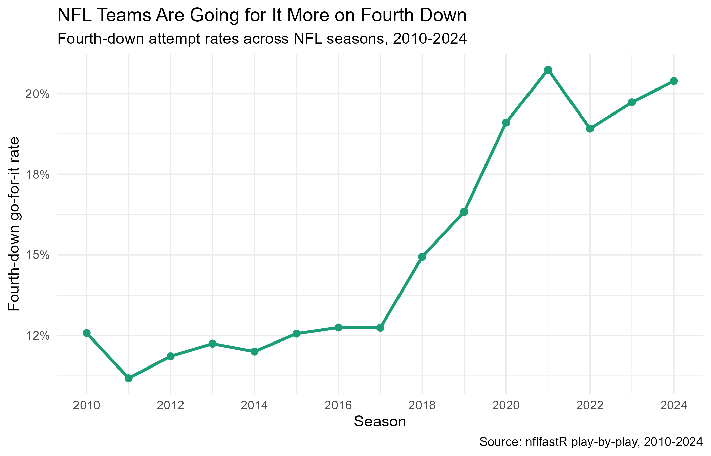
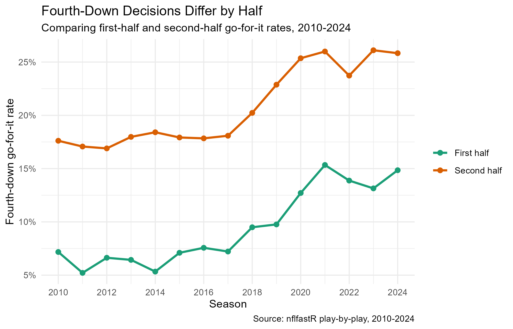
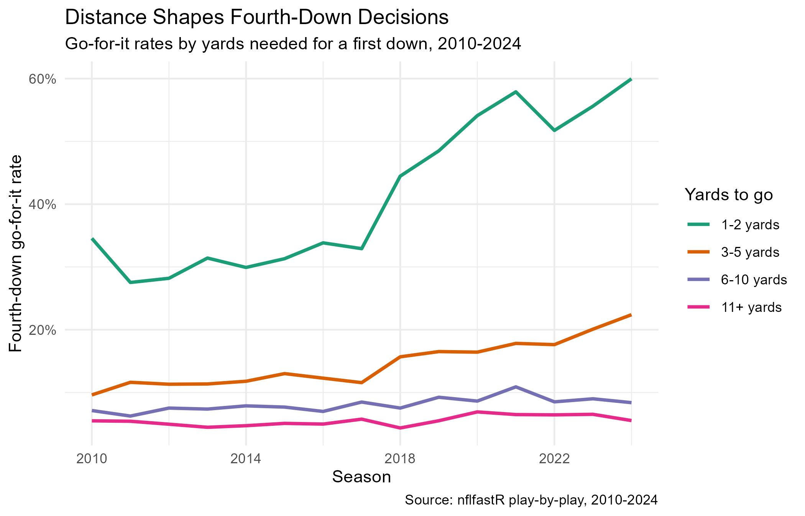

```{r loading-libraries-and-functions}
#| message: false
#| warning: false
#| include: false

library(here)
library(ggplot2)
library(dplyr)
library(scales)
source(here("pages", "project", "src", "functions", "save_plot_as_png.R"))
```

```{r getting-data}
#| message: false
#| warning: false
#| include: false

# run the cleaning script, which reads the raw data and writes the cleaned file
source(here("pages", "project", "src", "data", "nfl_data_cleaning.R"))

# read the cleaned data produced by the script above
fourth_down <- readRDS(
  here("pages", "project", "data", "cleaned", "nfl_fourth_down_cleaned.Rds")
)
```

## Introduction

This project examines how NFL teams' fourth-down decision-making changed from 2010 to 2024. Specifically, I investigate whether teams have become more aggressive about going for it on fourth down and how these trends differ by half and yards needed for a first down. Understanding these patterns helps show how NFL coaching strategies have evolved over time.

```{r plot-overall-trend}
#| echo: false
#| message: false
#| warning: false

overall_trend <- fourth_down |>
  group_by(season) |>
  summarise(go_rate = mean(went_for_it), .groups = "drop") |>
  ggplot(mapping = aes(x = season, y = go_rate)) +
  geom_line(linewidth = 1, color = "#1B9E77") +
  geom_point(size = 2, color = "#1B9E77") +
  scale_y_continuous(labels = label_percent(accuracy = 1)) +
  scale_x_continuous(breaks = seq(2010, 2024, by = 2)) +
  labs(
    title = "NFL Teams Are Going for It More on Fourth Down",
    subtitle = "Fourth-down attempt rates across NFL seasons, 2010-2024",
    x = "Season",
    y = "Fourth-down go-for-it rate",
    caption = "Source: nflfastR play-by-play, 2010-2024"
  ) +
  theme_minimal()

save_plot_as_png(
  plot = overall_trend,
  file_name = "fourth-down-trend.png"
)
```

{width=90% fig-alt="Line chart of NFL fourth down go-for-it rate by season from 2010 to 2024."}

This graph shows how the percentage of fourth downs on which NFL teams attempt to gain a first down has changed from 2010 to 2024. It allows us to see whether teams have become more willing to take risks rather than punt or attempt a field goal.

```{r plot-by-half}
#| echo: false
#| message: false
#| warning: false

half_trend <- fourth_down |>
  mutate(half = if_else(qtr <= 2, "First half", "Second half")) |>
  group_by(season, half) |>
  summarise(go_rate = mean(went_for_it), .groups = "drop") |>
  ggplot(mapping = aes(x = season, y = go_rate, color = half)) +
  geom_line(linewidth = 1) +
  geom_point(size = 2) +
  scale_y_continuous(labels = label_percent(accuracy = 1)) +
  scale_x_continuous(breaks = seq(2010, 2024, by = 2)) +
  scale_color_brewer(palette = "Dark2") +
  labs(
    title = "Fourth-Down Decisions Differ by Half",
    subtitle = "Comparing first-half and second-half go-for-it rates, 2010-2024",
    x = "Season",
    y = "Fourth-down go-for-it rate",
    color = NULL,
    caption = "Source: nflfastR play-by-play, 2010-2024"
  ) +
  theme_minimal()

save_plot_as_png(
  plot = half_trend,
  file_name = "fourth-down-by-half.png"
)
```

{width=90% fig-alt="Line chart comparing first half and second half fourth down go-for-it rates by season."}

This graph compares fourth-down go-for-it rates during the first and second halves of NFL games from 2010 to 2024. By separating the data by half, we can examine whether teams approach fourth-down decisions differently depending on when they occur during a game and whether these patterns have changed over time.

```{r plot-by-distance}
#| echo: false
#| message: false
#| warning: false

distance_trend <- fourth_down |>
  mutate(
    distance_bucket = factor(
      distance_bucket,
      levels = c("1-2 yards", "3-5 yards", "6-10 yards", "11+ yards")
    )
  ) |>
  group_by(season, distance_bucket) |>
  summarise(go_rate = mean(went_for_it), .groups = "drop") |>
  ggplot(mapping = aes(x = season, y = go_rate, color = distance_bucket)) +
  geom_line(linewidth = 1) +
  scale_y_continuous(labels = label_percent(accuracy = 1)) +
  scale_x_continuous(breaks = seq(2010, 2024, by = 4)) +
  scale_color_brewer(palette = "Dark2") +
  labs(
    title = "Distance Shapes Fourth-Down Decisions",
    subtitle = "Go-for-it rates by yards needed for a first down, 2010-2024",
    x = "Season",
    y = "Fourth-down go-for-it rate",
    color = "Yards to go",
    caption = "Source: nflfastR play-by-play, 2010-2024"
  ) +
  theme_minimal()

save_plot_as_png(
  plot = distance_trend,
  file_name = "fourth-down-by-distance.png"
)
```

{width=90% fig-alt="Line chart of fourth down go-for-it rate by season, split by yards to go."}

This graph compares fourth-down go-for-it rates based on the number of yards needed for a first down. The categories are 1-2 yards, 3-5 yards, 6-10 yards, and 11 or more yards. Teams appear much more likely to attempt a fourth-down conversion when fewer yards are needed, suggesting that distance plays an important role in their decision-making.

## Conclusion

Overall, this analysis explores how NFL fourth-down strategies have evolved between 2010 and 2024. By looking at overall trends, differences between halves, and yards needed for a first down, we can better understand the factors influencing coaches' decisions. The results suggest that distance is an important factor in fourth-down decision-making, while the historical comparisons help reveal how teams' willingness to take risks has developed over time.
